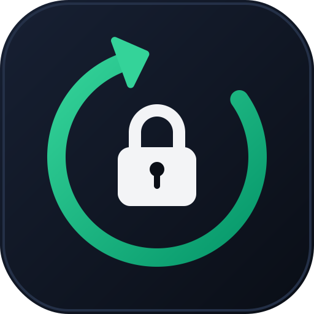

<p align="center">
  
</p>

<h1 align="center">Browser Backup Manager</h1>

<p align="center">
  Back up a browser's <b>entire</b> profile into one encrypted file, reset the browser to a fresh
  install, and restore everything (cookies included) with a single password.
</p>

<p align="center">
  
  
  
</p>

> **Heads-up:** the *Reset browser* feature permanently deletes a browser's data and the app
> force-closes browsers before it works. Read [Disclaimer](#disclaimer) and make one test backup
> and restore before you rely on it (turn browser sync off first: see [Browser sync](#browser-sync-turn-it-off-before-you-test-reset-or-restore)). The optional app lock is a basic convenience lock, **not**
> strong security: see [SECURITY.md](SECURITY.md).

## Features

- **One-file encrypted backups** of a browser's whole profile: cookies, logins, bookmarks,
  history, extensions and settings.
- **Strong encryption:** AES-256-GCM with a key derived by scrypt (128 MiB, memory-hard). The
  profile is archived, compressed and encrypted in a single stream, so no unencrypted copy is
  ever written to disk.
- **Safe by design:** backups are verified before they are kept, restores are authenticated
  before your browser data is touched, and a failed restore puts your original profile back.
- **Optional reset** of the browser to a fresh install after a verified backup.
- **Optional app lock** with a password, wrong-attempt delays and auto-lock when idle.
- **Backup library:** all backups listed with browser, name, date, size and file count.
- Works with **Brave, Google Chrome, Microsoft Edge, Vivaldi, Opera, Opera GX and Mozilla
  Firefox.**

## Why I made this: privacy on a shared PC

I made Browser Backup Manager for people who **share a computer** with family, roommates or
coworkers, and want their browser to be private without having to log out of everything and log
back in each time.

**How it works**

1. When you're done, **back up** your browser. Your whole profile (logins, cookies, bookmarks,
   history, extensions) goes into **one encrypted file** that only your password can open.
2. **Reset** the browser. It becomes a fresh install, so anyone who uses the PC after you sees an
   empty browser: none of your accounts, history or bookmarks.
3. When you're back, **restore** your backup. You're logged in to your accounts again, with
   everything where you left it, without typing a single password.

No cloud account is needed, nothing is uploaded, and it works fully offline. The source is open so
you can check that.

**Good to know**

- While your profile is restored, it's as exposed as any normal browser. The privacy comes from
  backing up and resetting when you leave.
- It keeps casual users out of your data. It does **not** protect you from someone with
  administrator access to the PC, malware, or a determined attacker. Reset deletes files
  normally and doesn't securely erase them.
- The backup file is encrypted, so someone who finds it can't read it, but they could delete it.
  Keep a copy somewhere else, such as a USB stick.
- Staying logged in depends on the websites. Some sites expire sessions or ask you to verify
  again, and Chrome and Edge restores have extra limits (see [Limitations](#limitations)).
- Turn browser sync off first, or it can bring your data back after a reset. See
  [Browser sync](#browser-sync-turn-it-off-before-you-test-reset-or-restore).
- See [SECURITY.md](SECURITY.md) for what is and isn't protected.

## Download

Get `BrowserBackupManager.exe` from the [Releases](../../releases) page. It is a single
portable file, with no installer. Prefer to compile it yourself? See [Build the EXE](#build-the-exe).

The EXE is **not code-signed**, so Windows SmartScreen may show "Windows protected your PC"
(click **More info → Run anyway**), and a few antivirus engines may flag it. See
[Antivirus and SmartScreen warnings](#antivirus-and-smartscreen-warnings). The window can take a
few seconds to appear on every start because the single-file build unpacks itself first.

**Verify your download** by comparing its SHA-256 hash with the one in the release notes:

```powershell
Get-FileHash .\BrowserBackupManager.exe -Algorithm SHA256
```

## Using the app

The window is resizable (minimum 860×560). A sidebar holds the **browser list**, the
navigation and the **backup folder**. Pick a browser first; entries marked "(not found)" are not
installed or used on this PC.

| Page | What it does |
|---|---|
| **Backups** | Lists every backup in your backup folder, newest first. Select one and click **Restore selected backup**. **Show backups of all browsers** widens the list, **Restore from file...** restores a backup stored elsewhere, **Delete backup file** removes one. |
| **Create backup** | Optional name, an encryption password (12+ characters, easily guessed ones are rejected) and an optional "reset the browser afterwards". Saved automatically as `<browser>_<date>_<time>.bbvault` in the backup folder. |
| **Reset browser** | Wipes the selected browser like a fresh install, **without** making a backup. Needs two confirmations, including typing the browser's name. |
| **Security** | Turn the app lock on or off, change the app password, or lock now. |

**Backup folder:** defaults to `Documents\Browser Backups`. Use **Change...** to pick another
folder (remembered in `%APPDATA%\BrowserBackupManager\config.json`) and **Open** to view it.
A folder inside a browser's own data folder is refused, because a reset would delete the
backups. If the folder is synced by OneDrive, Dropbox, Google Drive and similar, the app warns
you that the encrypted file and its `.meta.json` will be uploaded.

Next to each backup is a small `.meta.json` with the browser, name, date and file count, so the
list can be shown without the password. It contains no browsing data. If you delete it, the
backup still works and the browser is guessed from the file name.

## App lock (optional)

On first launch you choose **create an app password** (8+ characters) or **Continue without app
lock**. You can switch it on or off at any time on the **Security** page.

- **On:** the app asks for the password at every start and nothing is usable until then.
  **Lock now** (sidebar) locks it again, and it locks itself after 10 minutes without use
  (never during a backup, restore or reset).
- **Off:** the app opens directly. Turning the lock off needs the current app password.
- The password is stored only as a salted PBKDF2 hash (600,000 iterations) in
  `%APPDATA%\BrowserBackupManager\lock.json`. The lock is on exactly when that file exists.
- After 3 wrong attempts the app makes you wait (5 s, 10 s, 20 s ... up to 15 min). The wait
  survives closing and reopening the app, and also applies to turning the lock off.
- It is separate from the encryption password of your backups.
- **Limits (important):** this is a *basic* lock. It stops someone casually opening the app on
  your PC; it is **not** 100% secure and it **can be bypassed**. Anyone with access to your
  Windows account can delete or edit `lock.json`, or run the source code directly, and skip it.
  It does not encrypt anything and does not protect the backup files (those are protected only by
  their own passwords). If you forget the app password, deleting `lock.json` resets it; your
  backups are not affected. Details in [SECURITY.md](SECURITY.md).

## Security notes

Full threat model, known limits and how to report a vulnerability: [SECURITY.md](SECURITY.md).

- The backup password is never stored: not in the backup, the `.meta.json` or the app's
  settings. It only derives the key in memory. A wrong password is detected by AES-GCM
  authentication, and tampered or truncated files are rejected before your browser data is
  touched.
- A backup is written to a `.part` file, flushed to disk, re-opened and fully verified, and only
  then renamed. Nothing is deleted before that.
- A `.part` file in the backup folder is a backup in progress. It is removed automatically if a
  backup fails or is cancelled. If one is left behind (for example after a crash or power loss),
  it is incomplete, is not a valid backup, and is safe to delete.
- Restoring extracts to a staging folder and swaps it in only after the whole file has been
  authenticated. The swap renames your current profile aside, renames the new one in, and only
  then deletes the old one; if anything fails, the original is put back. You are asked whether
  to keep the previous data (unencrypted, in a `.before-restore-...` folder) until you have
  checked the result.
- The window cannot be closed while a backup, restore or reset is running.
- The `.meta.json` next to each backup is **not** encrypted (browser, name, date, file count),
  and the file size is visible. Do not put secrets in a backup's name.

## Browser sync: turn it off before you test, reset or restore

Edge, Chrome, Brave, Firefox, Vivaldi and Opera can sync your data to a cloud account
(bookmarks, passwords, history, extensions, settings). Sync runs by itself and it gets in the way
of this app:

- **A reset can look like it did nothing.** After a reset the browser starts like a fresh install,
  but if you are signed in (or it signs in automatically, as Edge can with your Windows Microsoft
  account), it downloads your data from the cloud again. Your bookmarks come back and you might
  think the reset or the backup did not work.
- **A test proves nothing.** If sync fills your data back in, you can't tell whether *your backup*
  restored it. You could believe the backup works when it is broken.
- **Sync can interfere with a restore.** Once the browser is back and online, sync may merge the
  cloud copy with the data you restored, which can overwrite or duplicate bookmarks and
  settings.

**What to do:** before you test (and ideally before any reset or restore), turn sync off or sign
out of the browser. Then make a unique bookmark such as "BBM TEST", back up, reset, check that it is
gone, restore, and check that it is back. You can turn sync on again afterwards.

Where to find it (menus change between versions, so search the settings for "sync" if needed):

| Browser | How to turn sync off |
|---|---|
| **Edge** | Settings > Profiles > Sync > turn sync off (or sign out). Also decline the "sign in with your Windows account" prompt on first run. |
| **Chrome** | Settings > You and Google > Sync and Google services > turn sync off (or sign out). |
| **Brave** | Settings > Sync > leave the sync chain. |
| **Firefox** | Settings > Sync > disconnect (or sign out of the Firefox account). |
| **Vivaldi / Opera / Opera GX** | Settings > Sync > log out. |

Sync is not a replacement for this app: it needs an account, it may not include everything (for
example, some data stays local), and it can replicate a mistake to all your devices. An encrypted
backup file is a separate copy that you control.

## Limitations

- **Chromium browsers** (Brave, Chrome, Edge, Vivaldi, Opera, Opera GX) encrypt cookies and saved
  passwords with a key tied to your Windows account. Restore works on the same account on the
  same PC; elsewhere, sites ask you to log in again (the app warns you). **Firefox** backups are
  portable.
- Recent Chrome and Edge versions use app-bound cookie encryption. A same-PC restore of the whole
  folder is the supported case, but test it once before relying on it. The app reminds you after
  every Chrome/Edge restore.
- The browser is force-closed (after you confirm) before any operation. Opera and Opera GX share
  one program, so both close.
- You need free disk space of roughly the compressed profile size for the backup file.
- **Losing the password means losing the backup.** There is no recovery.
- Caches are skipped to keep backups small. Firefox's cache lives outside its profile folder
  (Local AppData) and is not touched.
- Windows only.

## Run from source

```powershell
py -m venv .venv
.\.venv\Scripts\activate
pip install -r requirements.txt
python main.py
```

## Build the EXE

You need **Windows**, **Python 3.10+** ([python.org](https://www.python.org/downloads/); tick
*Add python.exe to PATH* during setup) and an internet connection for the first build (it
downloads the dependencies).

Open a terminal in the project folder and run **one command**:

```bat
build.bat
```

That installs the requirements and PyInstaller, then builds. The result is one portable file:
`dist\BrowserBackupManager.exe`. You can also just double-click `build.bat`.

If you would rather not use the script, this single command does the same thing in
**Command Prompt** (in PowerShell 5.1 replace `&&` with `;`):

```bat
py -m pip install -r requirements.txt pyinstaller && py -m PyInstaller --noconfirm --clean BrowserBackupManager.spec
```

Notes:

- Always build from `BrowserBackupManager.spec`, not a bare `pyinstaller main.py`: the spec
  bundles `app.ico` and customtkinter's theme files, and sets the single-file, windowed build.
- If `py` is not found, use `python` instead.
- The `build\` and `dist\` folders are created by the build and are safe to delete.
- Optional: install [UPX](https://upx.github.io/) and put it on your PATH for a smaller EXE;
  without it the build still works.
- Building produces an EXE for the Python and Windows architecture you build on (use 64-bit
  Python for a 64-bit EXE).
- To publish: copy the SHA-256 of the EXE into the release notes
  (`Get-FileHash .\dist\BrowserBackupManager.exe -Algorithm SHA256`).

## Antivirus and SmartScreen warnings

Unsigned single-file PyInstaller programs are a well-known source of false positives. The EXE
unpacks itself at startup, and this app does things that look suspicious to automated heuristics:
it closes browsers, reads browser profile folders, encrypts files and deletes folders. A few
heuristic or machine-learning engines may therefore flag it, usually with generic names such as
"Suspicious PE" or "Malware.<hash>" rather than a known malware family.

You don't have to trust the binary: the source is all here, it is small, and you can build the
EXE yourself with the steps above. Compare any download's SHA-256 hash with the release notes. If
a scanner flags a release, please open an issue so it can be reported to the vendor.

## Project layout

```
main.py                    GUI (CustomTkinter)
browser_backup/
  browsers.py              supported browsers and where their data lives
  browser.py               archiving, verifying, restoring, wiping, closing browsers
  crypto.py                streaming AES-256-GCM encryption with scrypt
  manager.py               create / restore / reset orchestration
  library.py               backup list and .meta.json files
  applock.py               optional app password and idle lock
  passwords.py             backup password strength check
  config.py, paths.py      settings and path helpers
build.bat                  one-command build script
BrowserBackupManager.spec  PyInstaller build settings
requirements.txt           runtime dependencies
SECURITY.md                security model, limits, reporting
```

## Disclaimer

This software is provided as is, without warranty (see [LICENSE](LICENSE)). It can delete
browser profiles. Always make a backup, restore it once to confirm it works, and keep your
backup password somewhere safe. You use it at your own risk.

## License

[MIT](LICENSE)
